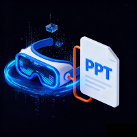
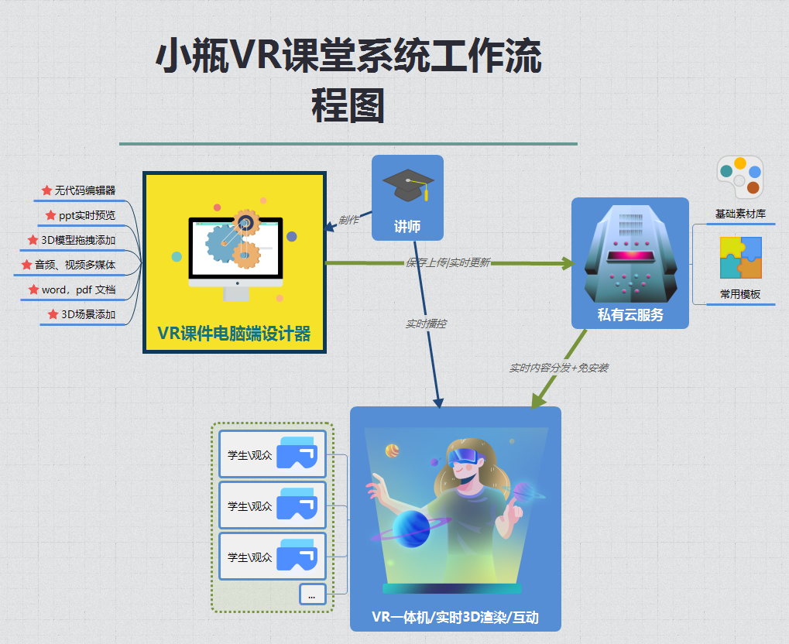

# vrClass Documentation Center

## Project Overview
vrClass is a virtual reality teaching solution designed for the education sector, offering features for creating and managing course materials. This project includes comprehensive user guides and operational documentation to help teachers quickly get started.

## Core Features
- Enterprise-grade data encryption and privacy protection
- Secure storage and management of teaching resources
- Support for VR course material creation and playback
- Robust file upload and management workflow

## Documentation Table of Contents
1. [User Guide](docs/guide/index.md)
   - Product Overview
   - Getting Started (Understanding the Product, Preparation, File Upload and Management)
   - Course Material Creation and Viewing Process
2. [Learning Path Recommendations](docs/guide/index.md)
   - Learning Path for New Teachers
   - Quick Start for Experienced Users
3. [Frequently Asked Questions](docs/guide/index.md)
   - Technical Issues
   - Content Creation Issues
   - Account Issues
4. [Get Help](docs/guide/index.md)
   - Feedback and Suggestions
   - Version Information

## Technical Support
Comprehensive documentation and feedback channels are provided to ensure users receive timely assistance during use.

To view the full documentation, visit the [Gitee Repository](https://gitee.com/pbottle/vrClass-document) for the latest version information.