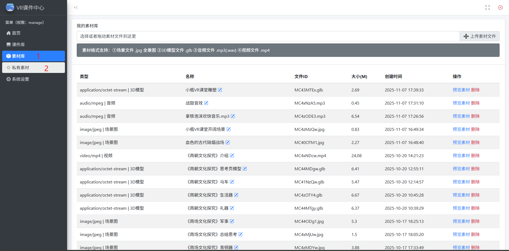

# 上传素材

你将学会：  
☐ 上传 3D 模型（`.glb`）  
☐ 上传视频（`.mp4`）  
☐ 上传音频（`.mp3`）  
☐ 上传场景图（`.jpg`）

预计用时：5 分钟  
前置条件：已登录后台，已准备好素材文件

---

### 进入素材管理页面

1. 点击左侧菜单栏的 **「素材库」**。
2. 在展开的子菜单中，点击 **「私有素材」**。
   

---

### 上传方式二选一

**方法一：点击上传按钮**

- 在素材管理页面，点击 **「➕ 上传素材文件」** 按钮。
- 在弹出的窗口中选中你的素材文件，点击打开。

**方法二：拖拽上传**

- 打开电脑文件夹，找到素材文件。
- 直接把文件拖到浏览器页面的上传区域，松手即可。

两种方法效果一样，你喜欢哪个就用哪个。

---

### 上传进度与结果

- 文件开始上传后，会显示进度条。
- 上传完成后，文件会自动出现在下方的素材列表中。
- 列表里会显示素材类型、名称、文件大小、上传时间。

> 预期结果：新素材出现在列表中，类型图标正确（如 3D 模型显示对应图标）。  
> 如果失败：检查文件格式是否符合要求（[参考清单](./素材从哪里来？.md)），文件不要太大。

---

### 上传建议

- 上传 3D 模型前，确保模型面数合理，文件不超过 20MB。
- 视频文件若较大，请耐心等待，不要关闭浏览器。
- 上传后建议立刻检查：[管理素材](./管理素材.md) 中预览一下是否能正常显示。

---

## 下一步

素材上传好了，你可以：

- [管理素材](./管理素材.md)（重命名、预览、删除）
- 或者直接开始 [认识课件编辑界面](./编辑课件-界面介绍.md)
