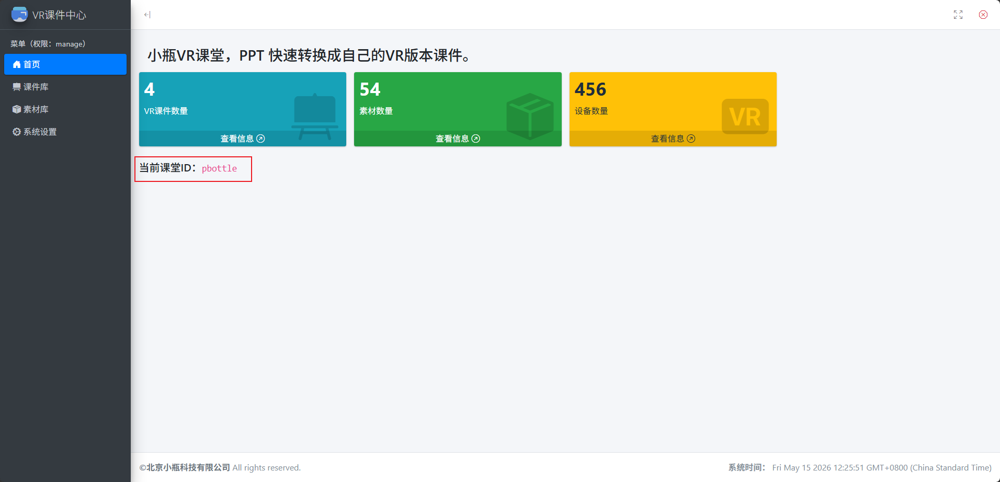

# 登录后台

你将学会：  
☐ 注册小瓶VR课堂账号  
☐ 登录后台并找到你的空间 ID

预计用时：5 分钟  
前置条件：已联系客服获取注册权限

---

### 第 1 步：联系客服获取账号

小瓶VR课堂目前采用授权注册制，你需要先联系客服开通账号。

- 扫码下方二维码添加客服微信  
  
- 提供你的姓名、学校/机构名称，客服会为你创建账号。
- 获取账号后，你会得到 **用户名** 和 **初始密码**。

---

### 第 2 步：登录后台

1. 打开浏览器，访问 [https://vr.pbottle.com/class/](https://vr.pbottle.com/class/)。
2. 输入客服给你的用户名和密码。
3. 点击「登录」按钮。

> 预期结果：页面跳转到“VR 课件中心”首页。  
> 如果登录失败：检查用户名密码是否输入正确，或联系客服重置密码。

---

### 第 3 步：找到你的空间 ID

空间 ID 就像你的专属课室门牌号，在 VR 眼镜中输入它就能看到你的课件。

1. 在课件中心首页，找到 **「当前课堂 ID」** 标签。
2. 后面那串字母数字就是你的空间 ID（例如 `pbottle`）。
3. 建议你现在就把它记录在手机备忘录或笔记本里。
   

> 安全提醒：空间 ID 是私密信息，不要随意发给陌生人。如果怀疑泄露，联系客服更换。

---

## 接下来做什么？

你已经成功登录，并知道了自己的空间 ID。下一步：

- [上传课件](./上传课件.md)
