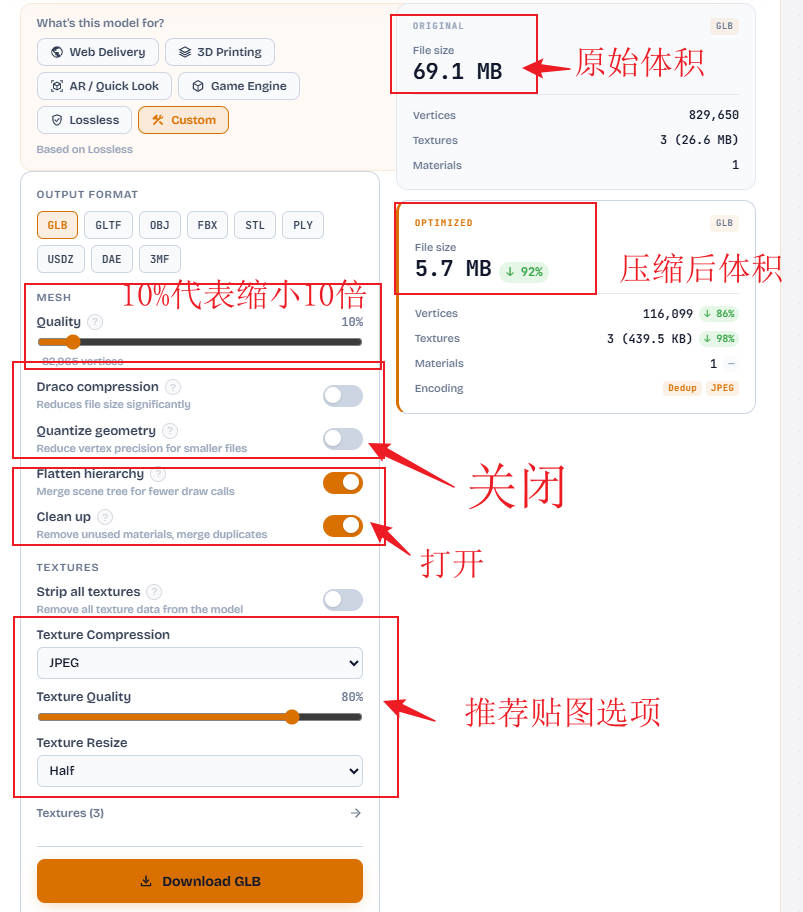
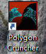

# 素材体积压缩优化

小瓶VR课堂为什么要压缩素材体积？

- 节省带宽和时间：小瓶VR课堂实时在线显示，素材体积越小，下载速度越快，存储空间越小，用户体验越好。
- 节省客户端 GPU 资源：小瓶VR课堂一般运行在VR一体机中，避免画面卡顿，保证较高的渲染帧率。

你将学会：  

- 如何压缩3D模型的体积
- 如何压缩场景图的体积
- 如何压缩音视频素材的体积

预计用时：3 分钟  
前置条件：已经获取素材文件

## 3D 模型文件压缩优化

#### 在线工具

**[优化3D模型工具，点击打开](https://polyforge.xyz/optimize)**

免费免登录，一键优化。

步骤：
1. 点击 「Select file」，上传原始 3D 模型文件
2. 按照下图设置参数开始优化，简单模型建议3M以下，复杂模型建议5M以下
3. 等待优化完成，点击「Download GLB」下载优化后的 3D 模型文件

#### 离线本地工具

推荐工具：

- Polygon Cruncher 

网络搜索「Polygon Cruncher」，压缩模型教程

## 场景图体积压缩优化

推荐使用电脑系统自带默认看图工具

步骤：
1. 打开场景图文件
2. 右键点击图片，菜单「调整图片大小」
3. 调整图片保存格式JPG格式, 质量一般选择 80%

## 音频体积压缩优化

推荐使用在线工具，免注册免登录

https://toolshu.com/audio-compressor

步骤：
1. 「点击或者托拽音频文件」，上传原始音频文件
2. 点击「开始处理」开始优化
3. 等待优化完成，处理结果下载优化后的音频文件

## 视频体积压缩优化

推荐使用在线工具，免注册免登录

https://toolshu.com/video-compress

步骤：
1. 「点击或者托拽视频文件」，上传原始视频文件
2. 点击「开始压缩」开始优化
3. 等待优化完成，处理结果下载优化后的视频文件