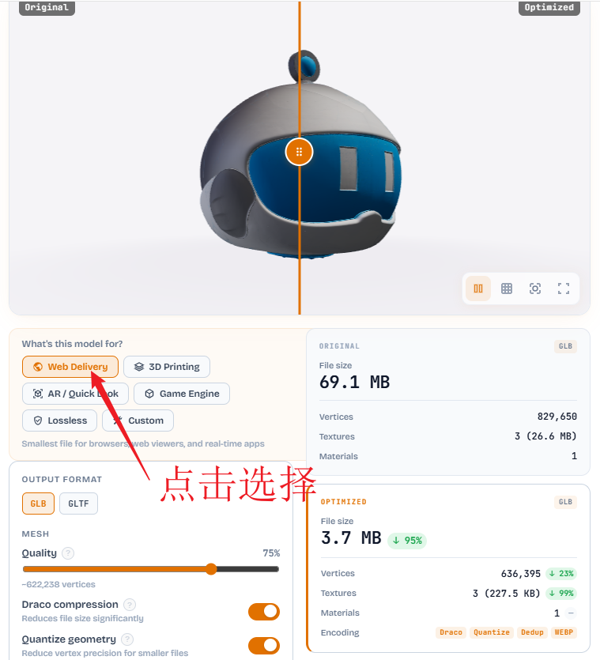
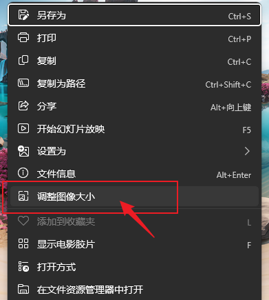
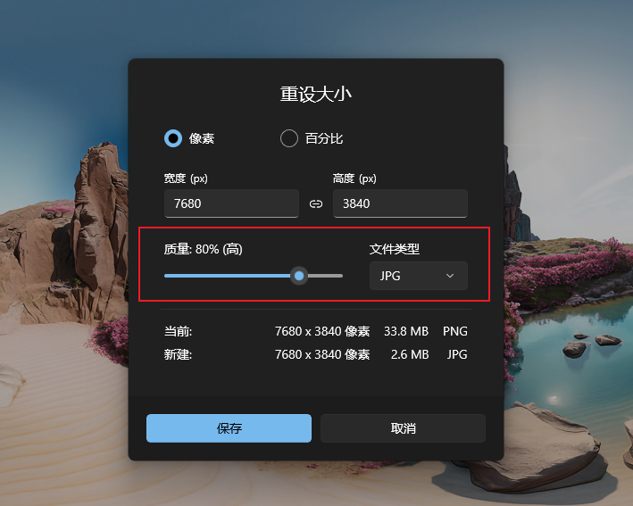

# 素材体积压缩优化

小瓶VR课堂为什么要压缩素材体积？

- 节省带宽和时间：小瓶VR课堂实时在线显示，素材体积越小，下载速度越快，存储空间越小，用户体验越好。
- 节省客户端 GPU 资源：小瓶VR课堂一般运行在VR一体机中，避免画面卡顿，保证较高的渲染帧率。

你将学会：  
☐ 如何压缩3D模型的体积
☐ 如何压缩场景图的体积
☐ 如何压缩音视频素材的体积

预计用时：3 分钟  
前置条件：已经获取素材文件

### 3D 模型文件压缩优化

**推荐在线工具，免下载安装**

**[优化3D模型工具，点击打开](https://polyforge.xyz/optimize)**

免费免登录，一键优化。

步骤：
1. 点击 「Select file」，上传原始 3D 模型文件
2. 点击「Web Delivery」开始优化
3. 等待优化完成，点击「Download GLB」下载优化后的 3D 模型文件

### 场景图体积压缩优化

推荐使用电脑系统自带默认看图工具

步骤：
1. 打开场景图文件
2. 右键点击图片，菜单「调整图片大小」
3. 调整图片保存格式JPG格式, 质量一般选择 80%

