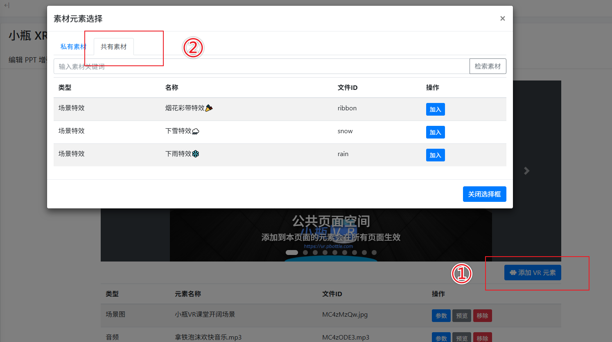

# 添加特效元素

你将学会：  
☐ 找到并进入课件编辑页面  
☐ 认识编辑界面的各个区域  
☐ 理解“公共页面空间”的作用

预计用时：3 分钟  
前置条件：已上传至少一个课件

---

### 进入编辑页面

1. 进入 [课件管理](./管理课件.md) 页面。
2. 在目标课件所在行，点击 **「编辑 VR 元素」** 按钮。
3. 系统会跳转到 VR 课件编辑界面。
   

公共特效元素目前有三种：

- 烟花彩带特效
- 下雨特效
- 下雪特效

---

### 操作视图

整个编辑界面分为 4 个核心区域：

