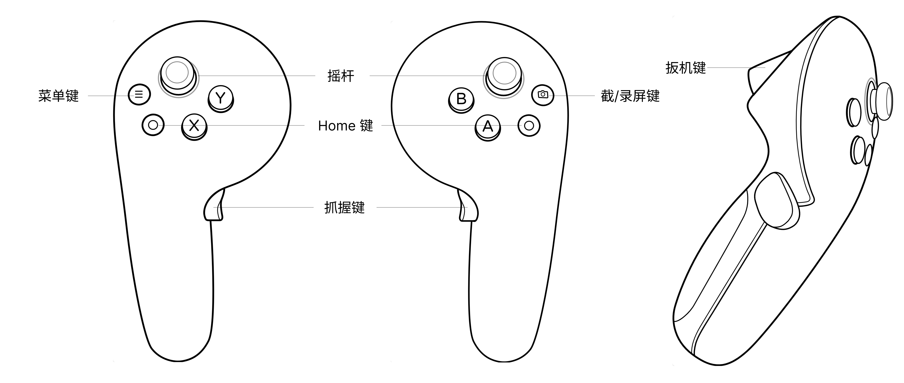

# 操控VR课件

你将学会：  
☐ 使用 PICO 3 手柄控制课件翻页  
☐ 播放和暂停视频  
☐ 在 VR 空间中环顾四周

预计用时：5 分钟  
前置条件：已打开一个课件

---

### PICO 3 手柄按键说明

在操作课件之前，先认识一下你手中的 PICO 3 手柄：

| 按键        | 位置                   | 在课件中的作用       |
| ----------- | ---------------------- | -------------------- |
| **摇杆**    | 手柄顶部，大拇指操作   | 上下滚动课件列表     |
| **扳机键**  | 手柄背面，食指扣动     | 确认选择、点击按钮   |
| **Home 键** | 手柄正面，PICO Logo 键 | 返回 PICO 系统主界面 |
| **返回键**  | 手柄正面，Home 键下方  | -         |

> 实际操控课件的核心键就两个：**摇杆** 负责滚动，**扳机键** 负责点击。

---

### 基本操作

#### 翻页

1. 找到课件画面下方的 **翻页按钮**（左箭头 ← 和右箭头 →）。
2. 移动手柄，将准星对准箭头按钮。
3. 扣动 **扳机键** 点击。
4. 点击右箭头翻到下一页，左箭头翻回上一页。

> 就像在手机上用手指左右滑动，只不过这里是用准星 + 扳机键来操作。

#### 环顾四周

- 你不需要任何按键，直接 **自然转动头部** 即可。
- 如果你的课件添加了全景图背景，转头就能看到 360° 环绕的场景。
- 如果添加了 3D 模型，可以走近或绕着模型走动观看（需注意安全边界）。

---

### 视频控制

如果当前页面包含视频，你可以在 VR 中直接控制播放。

1. 用准星对准视频画面。
2. 视频下方会出现控制条，包含以下按钮：

| 按钮   | 功能             |
| ------ | ---------------- |
| ▶ / ⏸  | 播放 / 暂停      |
| 进度条 | 拖动调整播放位置 |
| 倍速   | 调整播放速度     |
| 音量   | 调整视频音量     |

3. 将准星对准对应按钮，扣动 **扳机键** 即可操作。

> 注意：控制条可能几秒后自动隐藏，重新对准视频画面会再次出现。

---

### 返回课件列表

- 在课件界面找到 **「返回」** 或 **「返回主页」** 按钮。
- 用准星点击即可退出当前课件，回到课件选择列表。

---

### 操作小技巧

- **对准再按**：新手最容易犯的错是扳机键按了但没反应，通常是因为准星没对准目标。确认高亮后再按。
- **手腕微调**：大幅移动手臂容易累，轻轻转动手腕就能调整准星位置。
- **坐姿建议**：坐在固定椅子上观看更稳定，也降低了碰到周围物品的风险。

---

### 观看安全提醒

- 确保周围有至少 2 米 × 2 米的安全活动空间，清除障碍物。
- 每次连续观看不超过 30 分钟，如有眩晕感立即摘下头显休息。
- 儿童使用时必须有成人监护。

---

## 你已学完所有 VR 端操作！

恭喜！你已经掌握了在 VR 眼镜中观看课件的全部技能。

**回顾全流程**：

1. [安装应用](./安装VR应用.md)
2. [登录你的空间](./登录VR应用.md)
3. [浏览和打开课件](./浏览和打开课件.md)
4. [操控课件](./操控VR课件.md)（本文）

如果需要调整课件内容，回到电脑上打开后台：[认识编辑界面](../backend/编辑课件-界面介绍.md)

遇到问题？联系客服：010-86399882（工作日 9:00-18:00）
