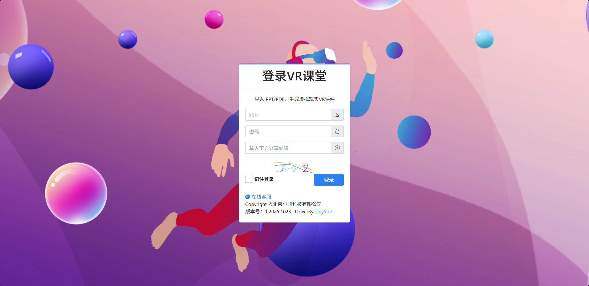
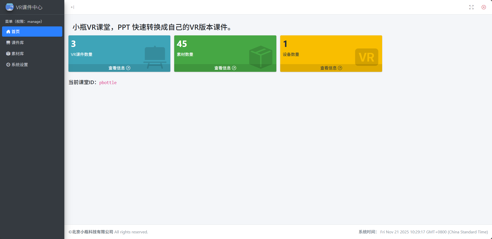

# 准备工作

在开始使用小瓶 VR 课堂之前，您需要完成一些基础准备工作。这些准备工作将确保您能够顺利地上传课件、制作 VR 教学内容并在 VR 设备中观看课件。

## 获取应用

首先，您需要在 VR 设备上安装小瓶 VR 课堂应用程序。目前该应用支持 PICO 系列 VR 设备。

### 下载安装方式

**方式一：直接访问应用商店**

- 访问 [PICO 应用商店地址](https://store.picoxr.com/cn/detail/1/7546489817597558799)
- 点击"安装"按钮下载并安装小瓶 VR 课堂应用
- 安装完成后可在 VR 设备的应用列表中找到该应用

**方式二：在应用商店中搜索**

- 打开 PICO VR 设备中的应用商店
- 在搜索框中输入"小瓶 VR 课堂"
- 在搜索结果中找到应用并点击安装

### 应用功能概览

小瓶 VR 课堂应用主要包括以下功能：

- 浏览和观看 VR 课件
- 通过空间 ID 切换不同用户的课件库
- 支持手柄操作进行课件浏览和交互
- 提供沉浸式的教学体验

### 系统要求

为确保应用正常运行，请确认您的设备满足以下要求：

- PICO VR 头显设备（支持 PICO 4、PICO Neo3 等主流型号）
- 稳定的网络连接（建议 Wi-Fi 环境）
- 设备系统已更新至最新版本

## 获取空间 ID

空间 ID 是小瓶 VR 课堂的核心概念，它相当于您的个人专属云空间，用于存储和管理您的课件及素材资源。

### 什么是空间 ID？

空间 ID 是一个唯一的字符串标识符，用于区分不同用户的云端资源。通过空间 ID，您可以：

- 在官网上传和管理自己的课件
- 在 VR 设备中访问专属课件库
- 实现多设备间的数据同步

### 获取步骤

1. **访问官网**

   - 打开浏览器，访问[小瓶 VR 课堂官网](https://vr.pbottle.com/class/)
   - 进入登录页面，注册或登录账号
     

2. **账号注册/登录**

   - 如果您是新用户，请点击"在线客服"按钮咨询客服以获取账号
   - 如果您已有账号，直接输入用户名和密码登录
   - 登录成功后，系统会自动跳转到 VR 课件中心首页
     

3. **查找空间 ID**
   - 登录后进入课件中心首页
   - 在页面显著位置找到【当前课堂 ID】标识
   - 其后的字符串即为您的个人空间 ID
     

### 空间 ID 使用说明

- **唯一性**：每个用户拥有唯一的空间 ID
- **私密性**：请妥善保管您的空间 ID，避免泄露给他人
- **共享功能**：您可以将空间 ID 分享给其他用户，让他们访问您的公开课件，但空间 ID 绑定的设备有上限
- **切换方式**：在 VR 应用中可以通过设置界面切换不同的空间 ID

### 注意事项

1. **账号安全**

   - 请设置强度较高的密码并定期更换
   - 不要在公共场所透露您的账号信息
   - 如怀疑账号被盗，请及时联系客服处理

2. **空间 ID 保护**

   - 空间 ID 相当于您的数字身份标识，请勿随意分享
   - 如需共享课件，请使用咨询官方客服设备绑定上线
   - 发现异常访问请及时检查并联系技术支持

3. **网络环境**
   - 建议在稳定的 Wi-Fi 环境下使用服务
   - 上传大文件时请确保网络带宽充足
   - 如遇到连接问题，请检查防火墙设置

完成以上准备工作后，您就可以开始使用小瓶 VR 课堂的各项功能了。建议先熟悉官网操作界面，再在 VR 设备中体验课件观看功能。
