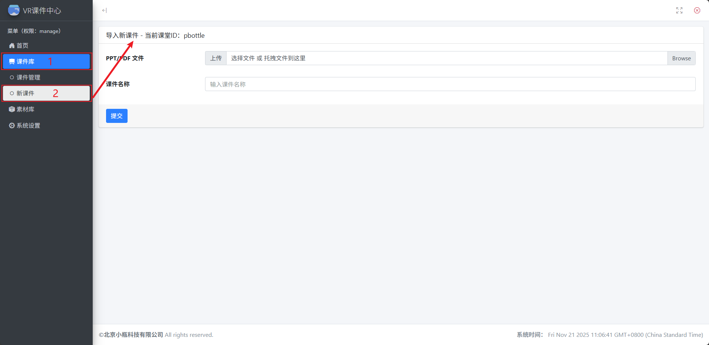
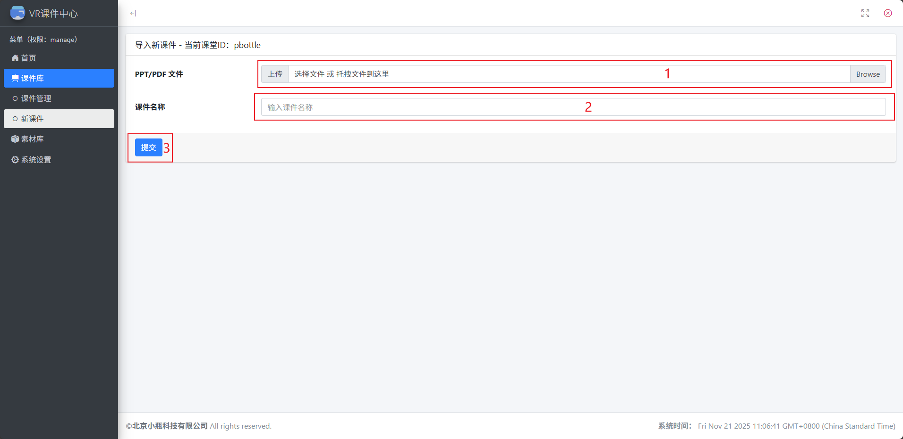

# 文件上传

## 上传课件

1. 按照下图所示步骤进入新课件上传界面：
   

   - 点击左侧菜单栏的"课件库"
   - 在展开的课件库菜单中点击"新课件"

2. 上传课件操作步骤：
   

   - 点击区域"1"选择要上传的课件文件
   - 在区域"2"输入课件名称（可自定义，默认为上传文件名）
   - 点击区域"3"的"提交"按钮完成上传

## 上传素材

1. 按照下图所示步骤进入素材库管理页面：
   

2. 素材上传操作步骤：

   - 点击"➕ 上传素材文件"按钮选择素材文件可完成素材上传
   - 直接拖拽素材文件到上传素材区域也可完成素材上传

## 支持的文件格式

小瓶 VR 课堂支持以下文件格式的上传：

- PPT 课件（.pdf）
- 3D 模型（.glb）
- 视频文件（.mp4）
- 音频文件（.mp3）
- 图片文件（.jpg）
