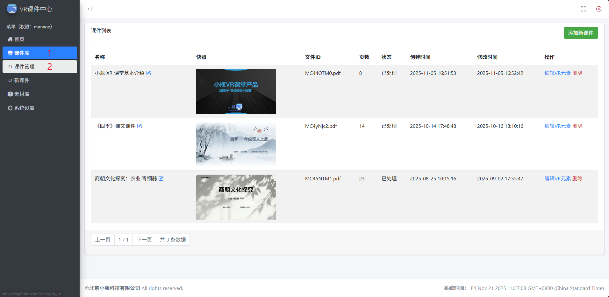

# 文件管理

## 管理课件

1. 按照下图所示步骤进入课件管理页面：

   

   - 点击左侧菜单栏的"课件库"
   - 在展开的课件库菜单中点击"课件管理"

2. 课件管理页面功能介绍

   - 课件列表：显示已上传的课件，列表显示的课件信息有：课件名称、课件快照、文件 ID、页数、状态、创建时间、修改时间
   - 课件操作：列表中每个课件都可以进行重命名、编辑 VR 元素和删除操作
   - 添加新课件：点击"添加新课件"按钮可进入添加课件页面

## 管理素材

1. 按照下图所示步骤进入素材库管理页面：
   

2. 素材管理功能介绍

   - 素材列表：显示已上传的素材，列表显示的素材信息有：素材类型、素材名称、文件 ID、大小、创建时间
   - 素材操作：列表中每个素材都可以进行重命名、预览素材、删除操作
