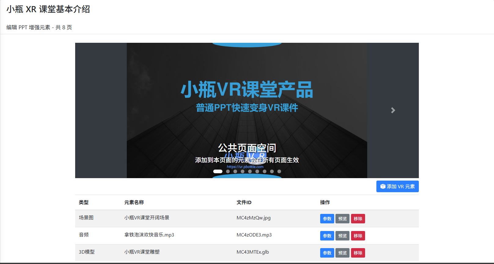

# 课件制作

在课件管理页面中，您可以对已上传的课件进行 VR 元素编辑，从而打造更具互动性和沉浸感的 VR 教学内容。在课件列表找到您想要编辑的课件，点击其对应的"编辑 VR 元素"按钮即可进入 VR 课件编辑界面。

## 编辑页面功能详解

### 1. 公共页面空间

这是一个特殊的全局配置页面，具有以下特点：

- 添加到本页面的元素会在所有幻灯片页面中生效
- 适用于需要在每一页都显示的元素，如 Logo、水印、背景音乐等
- 修改后无需逐页添加，大大提高编辑效率
- 常用于品牌标识、版权信息、背景氛围音效等全局元素

### 2. 页面切换功能

灵活的页面导航系统让您精确控制每一页的内容：

- 通过点击页面间的左右箭头按钮，可以在不同幻灯片页面之间自由切换
- 当前页面对应的页标会高亮显示，方便确认当前位置
- 支持为每一页单独添加不同的 VR 元素，满足个性化教学需求
- 可以随时返回公共页面空间进行全局设置调整

### 3. 添加 VR 元素

丰富的元素添加功能让您的课件更加生动：

- 点击"添加 VR 元素"按钮可以为当前选中的页面添加各类 VR 元素
- 支持多种媒体格式：3D 模型、视频、音频、环境图等
- 添加的元素会自动适配 VR 环境，提供沉浸式体验

### 4. 预览元素功能

实时预览确保编辑效果符合预期：

- 点击"预览"按钮可在网页中预览当前元素的展示效果

### 5. 移除元素功能

便捷的元素管理工具：

- 如果需要删除某个元素，点击该元素对应的"移除"按钮即可将其从当前页面移除
- 误删元素可通过重新添加恢复
- 移除操作即时生效，方便反复调试

## 添加 VR 元素详细操作步骤

### 步骤一：选择目标页面

- 首先通过页面切换功能，切换到您想要添加 VR 元素的具体幻灯片页面
- 确认当前页面编号无误后再进行后续操作

### 步骤二：启动添加流程

- 点击页面上的"添加 VR 元素"按钮
- 系统会立即弹出"素材元素选择"窗口，展示所有可用资源

### 步骤三：选择合适素材

- 在"素材元素选择"页面中，您可以查看所有已上传的素材元素
<!-- - 素材按照类型进行智能分类展示（3D 模型、视频、音频、图片等） -->

### 步骤四：完成元素添加

- 找到您想要添加的素材，点击该素材行尾部的"加入"按钮
- 系统会自动将该素材作为 VR 元素添加到当前页面
- 添加成功后可在页面元素列表中看到新增的元素

### 步骤五：验证添加效果

- 成功添加后，在 VR 设备重新打开该课件后，即可看到添加的元素
- 建议使用预览功能检查元素显示效果

## 高级使用技巧

### 性能优化要点

- 大型 3D 模型建议适当降低精度以保证流畅运行
- 视频元素应采用合适的编码格式和分辨率
- 定期清理不需要的元素以减少资源占用

## 使用建议

- **公共元素处理**：公共元素（如背景音乐、学校 3D Logo 等）建议添加到"公共页面空间"中，避免重复添加，同时便于统一管理。

- **个性化元素配置**：单个页面特有的元素（如特定模型、视频等）添加到对应的具体页面中，实现精准的内容匹配。

- **质量把控**：建议在添加元素后使用"预览"功能检查效果，确保元素本身正常显示<!--且不影响课件主要内容呈现-->。

- **版本迭代**：课件制作是一个持续优化的过程，建议定期回顾和更新 VR 元素，不断提升教学质量。
